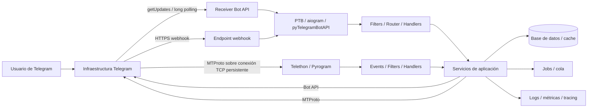
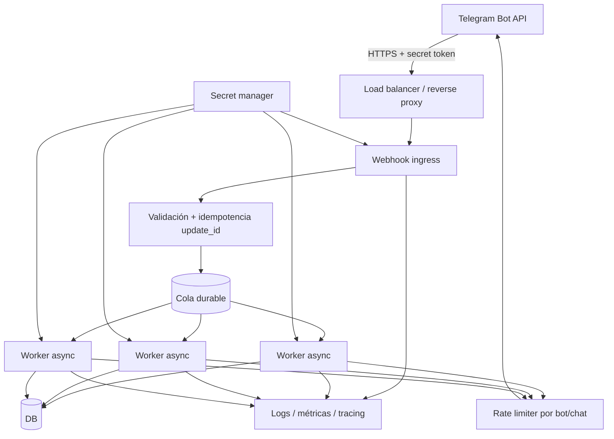
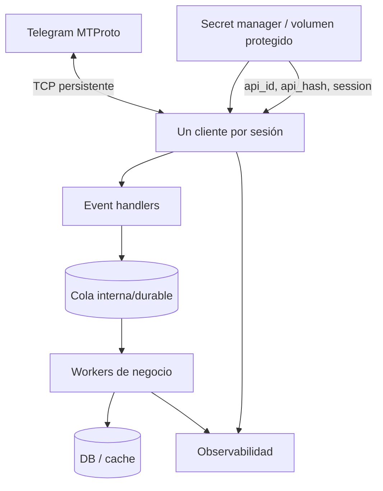

# Informe técnico sobre librerías Python para Telegram: python-telegram-bot, Pyrogram, Telethon, aiogram y telebot

> Nota de actualización (verificada de forma independiente, no solo tomada
> del informe): el archivado de Pyrogram (23-dic-2024, repo en solo
> lectura) está confirmado. TgCrypto corre la misma suerte por ser un
> proyecto satélite de Pyrogram — usar `cryptg` como alternativa viva para
> Telethon si hace falta acelerar criptografía/media.

**Índice** (867 líneas, consultá solo la sección que necesites):
- Resumen ejecutivo y tabla de estado por librería
- Panorama actual, documentación oficial y compatibilidad (incluye tabla "Bots frente a userbots/clientes de usuario")
- Guías de construcción por librería (instalación + ejemplo funcional completo: PTB, aiogram, pyTelegramBotAPI, Pyrogram, Telethon)
- Comparativa de APIs, código equivalente y flujos de arquitectura (incluye diagramas mermaid de producción para Bot API y para MTProto)
- Diagnóstico, límites, sesiones y resiliencia (rate limits, FloodWait, errores comunes, tabla de excepciones de aiogram)
- Migración, seguridad, testing y operación en producción
- Recomendaciones prácticas de elección y recursos (tabla de decisión por caso de uso + enlaces oficiales)

## Resumen ejecutivo

Para “telebot” asumo el paquete **pyTelegramBotAPI**, cuyo módulo de importación es `telebot`. Para cada proyecto tomo como referencia la **última versión estable publicada** a esta fecha; cuando la propia documentación va detrás de la API de Telegram, lo señalo expresamente. citeturn3view1turn4view3

La conclusión principal es que las cinco librerías ya no pertenecen a una sola categoría técnica. **python-telegram-bot, aiogram y pyTelegramBotAPI son, ante todo, frameworks alrededor de la HTTP Bot API** y por tanto están orientados a identidades bot creadas con BotFather. **Telethon y Pyrogram son clientes MTProto**, capaces de iniciar sesión tanto como usuario como con una identidad bot; esto cambia profundamente autenticación, sesiones, límites, despliegue y superficie de API. citeturn13search0turn14search9turn16view0turn19search3

A la fecha del informe, el panorama es éste:

| Librería | Estable tomada como referencia | Modelo | Estado y lectura práctica |
|---|---:|---|---|
| **python-telegram-bot** | **22.8**, 12-jun-2026 | Bot API, `asyncio` | Opción generalista muy sólida para bots. Python 3.10+. La 22.8 declara soporte nativo hasta **Bot API 10.0**, por lo que puede existir una pequeña ventana de retraso respecto de Telegram. citeturn13search0turn13search2 |
| **aiogram** | **3.31.0**, 26-ago-2026 | Bot API, async | La opción más convincente cuando son prioritarios routing modular, middlewares, DI, FSM, concurrencia y adopción rápida de Bot API: 3.31 declara **Bot API 10.3** y Python `>=3.10,<3.15`. citeturn3view0turn4view0turn14search3 |
| **pyTelegramBotAPI / telebot** | **4.36.1**, 13-ago-2026 | Bot API, sync y async | API muy accesible; mantiene `TeleBot` síncrono y `AsyncTeleBot`. Buena para bots pequeños/medianos y equipos que prefieren decoradores sencillos. citeturn4view2turn4view3turn21search0 |
| **Telethon** | **1.44.0**, 15-jun-2026 | MTProto, user y bot | Recomendación principal de este informe para nuevos proyectos que realmente necesitan un **cliente Telegram/userbot/MTProto**. La 1.44 usa la capa MTProto 227 y conserva un modelo de eventos maduro. citeturn2search3turn20view0turn19search5 |
| **Pyrogram** | **2.0.106**, 30-abr-2023 | MTProto, user y bot | Técnicamente agradable, pero **ya no se mantiene ni soporta** y el repositorio fue archivado. No lo elegiría para un greenfield de producción en 2026; sí documentaría/mantendría código existente mientras se prepara una migración. citeturn2search2turn0search1turn16view0 |

La diferencia de actualidad es especialmente importante. Por ejemplo, aiogram 3.31.0 declara soporte para Bot API 10.3, mientras python-telegram-bot 22.8 declara soporte nativo hasta Bot API 10.0. PTB permite acceder a funcionalidades todavía no modeladas nativamente mediante sus mecanismos de extensión, pero para un proyecto que necesite inmediatamente cada tipo/campo nuevo de Telegram conviene verificar la matriz de soporte antes de actualizar producción. citeturn3view0turn13search0

**Recomendación de base:** para un bot nuevo y estrictamente Bot API, empezaría por **python-telegram-bot** cuando valoro documentación, ergonomía y equilibrio, o por **aiogram** cuando el proyecto se parece más a un backend asíncrono grande con routers, middlewares, FSM, DI y mucha concurrencia. Para una integración sencilla o un código predominantemente síncrono, **pyTelegramBotAPI** sigue siendo atractivo. Para MTProto/userbots, escogería **Telethon**. No comenzaría un proyecto nuevo con Pyrogram debido a su estado de mantenimiento. citeturn13search5turn14search3turn14search4turn21search0turn16view0

## Panorama actual, documentación oficial y compatibilidad

Las fuentes que conviene considerar canónicas son, en este orden: documentación de Telegram, documentación estable de cada librería, PyPI del propio proyecto y repositorio/changelog oficial. Para comportamiento de rate limits de Bot API debe prevalecer Telegram, no el framework. Para MTProto, las condiciones de `FLOOD_WAIT` son dinámicas y no existe una tabla universal equivalente a los límites orientativos de Bot API. citeturn6search2turn6search20turn11view2turn19search7

| Proyecto | Documentación oficial | Código / repositorio | Releases y referencia | Español |
|---|---|---|---|---|
| Telegram Bot API | [core.telegram.org/bots/api](https://core.telegram.org/bots/api) | API mantenida por Telegram | [FAQ de bots](https://core.telegram.org/bots/faq) | La documentación técnica oficial principal se publica en inglés. citeturn6search11turn6search2 |
| Telegram MTProto | [core.telegram.org/api](https://core.telegram.org/api) | — | [Updates](https://core.telegram.org/api/updates), [layers](https://core.telegram.org/api/layers) | La referencia técnica canónica es la de Telegram. citeturn6search20turn6search22 |
| python-telegram-bot | [docs.python-telegram-bot.org/en/stable](https://docs.python-telegram-bot.org/en/stable/) | [github.com/python-telegram-bot/python-telegram-bot](https://github.com/python-telegram-bot/python-telegram-bot) | [PyPI](https://pypi.org/project/python-telegram-bot/), [changelog](https://docs.python-telegram-bot.org/en/stable/changelog.html) | No localicé una edición oficial es-MX/es de la documentación estable; la fuente canónica revisada es inglesa. citeturn3view3turn13search0turn13search2 |
| aiogram | [docs.aiogram.dev/en/latest](https://docs.aiogram.dev/en/latest/) | [github.com/aiogram/aiogram](https://github.com/aiogram/aiogram) | [PyPI](https://pypi.org/project/aiogram/), [changelog](https://docs.aiogram.dev/en/latest/changelog.html) | El propio proyecto señala documentación oficial en **inglés y ucraniano**, no español. citeturn3view0turn14search5 |
| pyTelegramBotAPI | [pytba.readthedocs.io/en/latest](https://pytba.readthedocs.io/en/latest/) | [github.com/eternnoir/pyTelegramBotAPI](https://github.com/eternnoir/pyTelegramBotAPI) | [PyPI](https://pypi.org/project/pyTelegramBotAPI/) | La distribución oficial enlaza documentación inglesa y rusa; no localicé una edición oficial española. citeturn3view1turn4view3 |
| Telethon | [docs.telethon.dev/en/stable](https://docs.telethon.dev/en/stable/) | [GitHub histórico: LonamiWebs/Telethon](https://github.com/LonamiWebs/Telethon) | [PyPI](https://pypi.org/project/Telethon/), [changelog](https://docs.telethon.dev/en/stable/misc/changelog.html), [TL reference](https://tl.telethon.dev/) | Documentación canónica inglesa. Atención: el changelog 1.43 indica que el proyecto dejó de estar alojado en GitHub; conviene seguir el enlace de fuente que publique la documentación vigente, no asumir que el histórico GitHub es canónico. citeturn3view2turn20view1 |
| Pyrogram | [docs.pyrogram.org](https://docs.pyrogram.org/) | [github.com/pyrogram/pyrogram](https://github.com/pyrogram/pyrogram) | [PyPI](https://pypi.org/project/Pyrogram/) | Documentación canónica inglesa; además, la propia portada advierte que el proyecto ya no se mantiene ni soporta. citeturn16view0turn2search2 |

Hay que evitar una confusión terminológica frecuente: usar un **bot token en Telethon o Pyrogram no transforma estas librerías en wrappers de la HTTP Bot API**. Continúan hablando MTProto con Telegram. Por eso necesitan `api_id` y `api_hash` al crear/autenticar la sesión; Pyrogram documenta explícitamente que incluso una nueva sesión de bot necesita la API key de Telegram además del token. citeturn10view0turn20view3

Para obtener `api_id` y `api_hash` de un cliente MTProto se utiliza la infraestructura de desarrolladores de Telegram en `https://my.telegram.org`; Telethon enlaza expresamente esta procedencia en su constructor. El `bot_token`, en cambio, corresponde a la identidad bot gestionada por BotFather. citeturn20view3

**Bots frente a userbots/clientes de usuario**

| Necesidad | PTB | aiogram | pyTelegramBotAPI | Telethon | Pyrogram |
|---|---:|---:|---:|---:|---:|
| BotFather bot | Sí | Sí | Sí | Sí, sobre MTProto | Sí, sobre MTProto |
| Login con teléfono como usuario | No | No | No | **Sí** | **Sí** |
| Bot API HTTP | **Sí** | **Sí** | **Sí** | No | No |
| MTProto/raw API | No | No | No | **Sí** | **Sí** |
| Webhook de Telegram | Sí | Sí | Sí | No es su modelo de actualización | No; docs dicen explícitamente que usa sockets TCP persistentes |
| Sesión autorizada persistente MTProto | No | No | No | `.session`/`StringSession` | `.session`/session string |

Pyrogram explica que no implementa webhooks porque el cliente mantiene sockets TCP persistentes y Telegram empuja las actualizaciones sobre esa conexión. Telethon sigue el mismo paradigma MTProto y dispone de almacenamiento de sesión y estado de updates. citeturn11view1turn19search0turn20view4

## Guías de construcción por librería

**python-telegram-bot 22.8**

PTB es completamente asíncrono desde la arquitectura moderna, requiere Python 3.10+ y se construye alrededor de `Application`, handlers y `ContextTypes`. Su repositorio advierte además que, desde v20, usa `asyncio` y no pretende ser thread-safe en general; esto favorece un diseño de un solo event loop con I/O asíncrono, no llamadas arbitrarias desde múltiples threads. citeturn13search0turn3view3

Instalación:

```bash
python -m pip install -U python-telegram-bot

# Para webhook + limitador de solicitudes:
python -m pip install -U "python-telegram-bot[webhooks,rate-limiter]"
```

Los extras oficiales incluyen, entre otros, soporte de webhooks, rate limiting, callback data y JobQueue. Desde v21.4 las releases publicadas por el proyecto están firmadas mediante Sigstore. citeturn13search0turn3view3

Autenticación: para un bot normal sólo necesitas el token; **no hay sesión MTProto**.

```python
import os

from telegram import (
    InlineKeyboardButton,
    InlineKeyboardMarkup,
    InlineQueryResultArticle,
    InputTextMessageContent,
    Update,
)
from telegram.ext import (
    Application,
    CallbackQueryHandler,
    CommandHandler,
    ContextTypes,
    InlineQueryHandler,
    MessageHandler,
    filters,
)

TOKEN = os.environ["TELEGRAM_BOT_TOKEN"]


async def start(update: Update, context: ContextTypes.DEFAULT_TYPE) -> None:
    keyboard = [[InlineKeyboardButton("Ping", callback_data="ping")]]
    await update.effective_message.reply_text(
        "Bot listo.",
        reply_markup=InlineKeyboardMarkup(keyboard),
    )


async def echo(update: Update, context: ContextTypes.DEFAULT_TYPE) -> None:
    await update.effective_message.reply_text(update.effective_message.text)


async def photo(update: Update, context: ContextTypes.DEFAULT_TYPE) -> None:
    await update.effective_message.reply_photo(
        photo="https://telegram.org/img/t_logo.png",
        caption="Multimedia desde PTB",
    )


async def callback(update: Update, context: ContextTypes.DEFAULT_TYPE) -> None:
    query = update.callback_query
    await query.answer("Pong")
    await query.edit_message_text("Callback procesado")


async def inline(update: Update, context: ContextTypes.DEFAULT_TYPE) -> None:
    q = update.inline_query.query
    result = InlineQueryResultArticle(
        id="echo",
        title="Responder",
        input_message_content=InputTextMessageContent(
            f"Consulta: {q or '(vacía)'}"
        ),
    )
    await update.inline_query.answer([result], cache_time=1)


async def on_error(update: object, context: ContextTypes.DEFAULT_TYPE) -> None:
    # En producción: logger.exception(...), sin imprimir token/PII.
    print(f"Error: {context.error!r}")


app = Application.builder().token(TOKEN).build()
app.add_handler(CommandHandler("start", start))
app.add_handler(CommandHandler("foto", photo))
app.add_handler(CallbackQueryHandler(callback, pattern=r"^ping$"))
app.add_handler(InlineQueryHandler(inline))
app.add_handler(MessageHandler(filters.TEXT & ~filters.COMMAND, echo))
app.add_error_handler(on_error)

app.run_polling(allowed_updates=Update.ALL_TYPES)
```

La documentación estable incluye ejemplos oficiales específicos para echo, teclados inline, callback queries, deep linking, Web Apps, errores, pagos y webhooks personalizados. citeturn13search5

**Middlewares:** PTB no basa su API pública en una tubería denominada `Middleware` como aiogram. Para lógica transversal conviene combinar filtros y grupos de handlers, `add_error_handler`, hooks de `Application`, `ContextTypes` personalizado y, cuando haga falta, wrappers propios alrededor de callbacks. El ejemplo oficial de `ContextTypes` muestra precisamente la extensión del contexto de ejecución. citeturn13search5

**Producción:** para un worker persistente, `run_polling()` es suficiente. Para infraestructura HTTP/autoscaling, usar `run_webhook()` o integrar `Application` con un servidor asyncio propio; PTB distribuye un ejemplo oficial de webhook personalizado con Starlette/Uvicorn. Sus funciones `run_*` implementan ciclo de inicio y apagado ordenado y `stop_running()` permite detenerlas de forma graceful. citeturn13search1turn13search17

**aiogram 3.31.0**

aiogram 3 usa una arquitectura de **Dispatcher + Router + filtros + middlewares + dependency injection**, exclusivamente asíncrona. `Dispatcher` es el router raíz; los routers anidados permiten dividir dominios y módulos sin concentrar toda la lógica del bot en un solo archivo. citeturn14search8turn14search9turn14search14

```bash
python -m pip install -U aiogram
```

Ejemplo completo:

```python
import asyncio
import os

from aiogram import BaseMiddleware, Bot, Dispatcher, F, Router
from aiogram.filters import Command, CommandStart
from aiogram.types import (
    CallbackQuery,
    FSInputFile,
    InlineKeyboardButton,
    InlineKeyboardMarkup,
    InlineQuery,
    InlineQueryResultArticle,
    InputTextMessageContent,
    Message,
)

TOKEN = os.environ["TELEGRAM_BOT_TOKEN"]
router = Router(name="main")


class RequestContextMiddleware(BaseMiddleware):
    async def __call__(self, handler, event, data):
        # Aquí: tracing, DB session, auth interna, métricas, etc.
        data["source"] = "telegram"
        return await handler(event, data)


router.message.outer_middleware(RequestContextMiddleware())


@router.message(CommandStart())
async def start(message: Message) -> None:
    kb = InlineKeyboardMarkup(
        inline_keyboard=[
            [InlineKeyboardButton(text="Ping", callback_data="ping")]
        ]
    )
    await message.answer("Bot listo.", reply_markup=kb)


@router.message(Command("foto"))
async def send_photo(message: Message) -> None:
    # También acepta file_id/URL según el método.
    photo = FSInputFile("foto.jpg")
    await message.answer_photo(photo, caption="Multimedia desde aiogram")


@router.callback_query(F.data == "ping")
async def callback(query: CallbackQuery) -> None:
    await query.answer("Pong")
    if query.message:
        await query.message.edit_text("Callback procesado")


@router.inline_query()
async def inline(query: InlineQuery) -> None:
    result = InlineQueryResultArticle(
        id="echo",
        title="Responder",
        input_message_content=InputTextMessageContent(
            message_text=f"Consulta: {query.query or '(vacía)'}"
        ),
    )
    await query.answer([result], cache_time=1)


@router.message(F.text)
async def echo(message: Message) -> None:
    await message.answer(message.text)


async def main() -> None:
    bot = Bot(TOKEN)
    dp = Dispatcher()
    dp.include_router(router)
    await dp.start_polling(bot)


if __name__ == "__main__":
    asyncio.run(main())
```

Los middlewares son una característica de primera clase; aiogram implementa **dos capas**, una antes y otra después del filtrado. También permite inyectar dependencias desde `Dispatcher`, desde `start_polling` o desde su integración de webhook. citeturn14search3turn14search4

Para callbacks, es importante responder a la `CallbackQuery`; la propia documentación ofrece incluso un middleware de callback-answer para automatizar esta operación en proyectos con muchos botones. citeturn14search7

Para estado conversacional, aiogram posee FSM; para producción no conviene depender de `MemoryStorage` si se necesita supervivencia a reinicios o varias instancias, porque la memoria local no es almacenamiento distribuido ni duradero. La documentación de storage lo advierte. citeturn12search15turn12search17

En despliegue hay dos caminos oficiales: `Dispatcher.start_polling()`/`run_polling()`, o webhook. Webhook y long polling **no pueden utilizarse simultáneamente** para el mismo bot. La documentación incluye integración con `aiohttp` mediante request handlers y permite integrar el dispatcher en un stack HTTP propio. citeturn14search0turn14search13

**pyTelegramBotAPI / `telebot` 4.36.1**

El nombre de paquete es `pyTelegramBotAPI`; el import es `telebot`. La librería conserva tanto una interfaz síncrona `TeleBot` como `AsyncTeleBot`. citeturn3view1turn21search0

```bash
python -m pip install -U pyTelegramBotAPI
```

Ejemplo síncrono:

```python
import os
import telebot
from telebot import types

TOKEN = os.environ["TELEGRAM_BOT_TOKEN"]
bot = telebot.TeleBot(TOKEN)


@bot.message_handler(commands=["start"])
def start(message):
    kb = types.InlineKeyboardMarkup()
    kb.add(types.InlineKeyboardButton("Ping", callback_data="ping"))
    bot.send_message(message.chat.id, "Bot listo.", reply_markup=kb)


@bot.message_handler(commands=["foto"])
def send_photo(message):
    with open("foto.jpg", "rb") as photo:
        bot.send_photo(message.chat.id, photo, caption="Multimedia desde telebot")


@bot.callback_query_handler(func=lambda call: call.data == "ping")
def callback(call):
    bot.answer_callback_query(call.id, "Pong")
    bot.edit_message_text(
        "Callback procesado",
        chat_id=call.message.chat.id,
        message_id=call.message.message_id,
    )


@bot.inline_handler(func=lambda query: True)
def inline(query):
    result = types.InlineQueryResultArticle(
        id="echo",
        title="Responder",
        input_message_content=types.InputTextMessageContent(
            f"Consulta: {query.query or '(vacía)'}"
        ),
    )
    bot.answer_inline_query(query.id, [result], cache_time=1)


@bot.message_handler(content_types=["text"])
def echo(message):
    bot.reply_to(message, message.text)


bot.infinity_polling(
    skip_pending=True,
    allowed_updates=["message", "callback_query", "inline_query"],
)
```

`infinity_polling()` envuelve el long polling en un ciclo con manejo de excepciones. La antigua `polling()` está marcada como **deprecated desde 4.1.1** en la documentación actual y se recomienda `infinity_polling()`. No debe arrancarse más de un proceso de polling concurrente sobre el mismo bot. citeturn22search0

La variante asíncrona conserva un estilo muy parecido:

```python
import asyncio
import os

from telebot.async_telebot import AsyncTeleBot

bot = AsyncTeleBot(os.environ["TELEGRAM_BOT_TOKEN"])


@bot.message_handler(commands=["start"])
async def start(message):
    await bot.reply_to(message, "Bot async listo")


async def main():
    await bot.infinity_polling(skip_pending=True)


asyncio.run(main())
```

`AsyncTeleBot` ofrece también `run_webhooks()`, `set_webhook()`, envío multimedia, handlers inline y callbacks. El webhook actual admite `secret_token`, que Telegram replica en el header `X-Telegram-Bot-Api-Secret-Token`. citeturn21search0turn22search1

La familia `telebot` dispone además de soporte de middlewares y filtros personalizados en su API actual. Para un proyecto grande conviene usarlos para autenticación interna, tracing y DB lifecycle, en vez de duplicar ese código en todos los decorators. citeturn3view1turn21search0

**Pyrogram 2.0.106**

La instalación histórica oficial es:

```bash
python -m pip install -U pyrogram tgcrypto
```

TgCrypto era recomendado para sustituir el procesamiento criptográfico Python puro por una implementación C y Pyrogram lo detecta automáticamente. Sin embargo, en 2026 conviene **fijar explícitamente `Pyrogram==2.0.106`** en sistemas heredados, en vez de tratarlo como una dependencia viva, porque el proyecto ya no se mantiene. citeturn17view0turn18view6turn16view0

Para un bot MTProto:

```python
import os

from pyrogram import Client, filters
from pyrogram.types import (
    InlineKeyboardButton,
    InlineKeyboardMarkup,
    InlineQueryResultArticle,
    InputTextMessageContent,
)

app = Client(
    "bot_session",
    api_id=int(os.environ["TG_API_ID"]),
    api_hash=os.environ["TG_API_HASH"],
    bot_token=os.environ["TELEGRAM_BOT_TOKEN"],
)


@app.on_message(filters.command("start"))
async def start(client, message):
    await message.reply_text(
        "Bot listo.",
        reply_markup=InlineKeyboardMarkup(
            [[InlineKeyboardButton("Ping", callback_data="ping")]]
        ),
    )


@app.on_message(filters.command("foto"))
async def photo(client, message):
    await message.reply_photo("foto.jpg", caption="Multimedia desde Pyrogram")


@app.on_callback_query(filters.regex(r"^ping$"))
async def callback(client, query):
    await query.answer("Pong")
    await query.message.edit_text("Callback procesado")


@app.on_inline_query()
async def inline(client, query):
    result = InlineQueryResultArticle(
        title="Responder",
        input_message_content=InputTextMessageContent(
            f"Consulta: {query.query or '(vacía)'}"
        ),
    )
    await query.answer([result], cache_time=1)


@app.on_message(filters.text & ~filters.command(["start", "foto"]))
async def echo(client, message):
    await message.reply_text(message.text)


app.run()
```

La documentación ofrece handlers por decorators y por `add_handler`, además de ejemplos específicos de callback queries e inline queries. citeturn11view0turn16view0

La autorización es distinta de Bot API: una sesión nueva de bot necesita `api_id`, `api_hash` y `bot_token`; una sesión de usuario usa credenciales de API y login por teléfono/código. Al autenticarse se crea por defecto un SQLite `<nombre>.session`, que se reutiliza en reinicios. También puede exportarse un session string para filesystems efímeros. citeturn10view0turn18view3turn18view4

Pyrogram no tiene una abstracción de middleware de primera clase equivalente a la de aiogram. Su composición tradicional se basa en filtros, grupos de handlers, decorators/wrappers y **Smart Plugins**. citeturn16view0

En producción **no debe configurarse un webhook**: Pyrogram documenta expresamente que MTProto no lo necesita porque opera con conexión TCP persistente. El proceso debe vivir como un worker de larga duración, con almacenamiento persistente para su `.session` o un session string suministrado desde un secret manager. citeturn11view1turn18view3

**Telethon 1.44.0**

Instalación estable:

```bash
python -m pip install -U telethon

# Opcional para acelerar criptografía/media:
python -m pip install cryptg
```

La documentación de Telethon recomienda `cryptg` cuando transferencia de archivos/criptografía pura de Python se convierte en cuello de botella. citeturn6search13turn20view5

Autenticación de bot:

```python
import os

from telethon import Button, TelegramClient, events

API_ID = int(os.environ["TG_API_ID"])
API_HASH = os.environ["TG_API_HASH"]
TOKEN = os.environ["TELEGRAM_BOT_TOKEN"]

client = TelegramClient(
    "bot",
    API_ID,
    API_HASH,
    connection_retries=5,
    auto_reconnect=True,
)


@client.on(events.NewMessage(pattern=r"^/start(?:@\w+)?$"))
async def start(event):
    await event.respond(
        "Bot listo.",
        buttons=[[Button.inline("Ping", data=b"ping")]],
    )


@client.on(events.NewMessage(pattern=r"^/foto(?:@\w+)?$"))
async def photo(event):
    await client.send_file(
        event.chat_id,
        "foto.jpg",
        caption="Multimedia desde Telethon",
    )


@client.on(events.CallbackQuery(data=b"ping"))
async def callback(event):
    await event.answer("Pong")
    await event.edit("Callback procesado")


@client.on(events.InlineQuery)
async def inline(event):
    result = event.builder.article(
        title="Responder",
        text=f"Consulta: {event.text or '(vacía)'}",
    )
    await event.answer([result])


@client.on(events.NewMessage)
async def echo(event):
    if event.raw_text and not event.raw_text.startswith("/"):
        await event.reply(event.raw_text)


client.start(bot_token=TOKEN)
client.run_until_disconnected()
```

Telethon no posee un `CommandHandler`: los comandos suelen modelarse mediante `events.NewMessage(pattern=...)`. Tiene eventos específicos para `NewMessage`, ediciones, eliminaciones, `CallbackQuery`, `InlineQuery`, acciones de chat y otras actualizaciones MTProto. citeturn19search1turn19search5

Para usuario:

```python
from telethon import TelegramClient

client = TelegramClient("usuario", API_ID, API_HASH)

# Primera ejecución: pedirá teléfono, código y, si aplica, contraseña 2FA.
client.start()
client.run_until_disconnected()
```

`TelegramClient.start()` admite bot token o autenticación de usuario; cuando hay 2FA puede intervenir `SessionPasswordNeededError`. citeturn6search1

No existe un middleware framework comparable al de aiogram; la composición se realiza con event builders, handlers y decorators/wrappers propios. Esto normalmente no es una carencia para clientes MTProto pequeños, pero sí significa que en una aplicación corporativa conviene crear explícitamente una capa de servicios alrededor de los handlers para DB, observabilidad, permisos e idempotencia.

Telethon ofrece `MemorySession`, `SQLiteSession` —la predeterminada— y `StringSession`. La sesión contiene suficiente información para volver a iniciar sesión sin solicitar de nuevo el código. Su documentación es categórica: un `StringSession` debe tratarse como una credencial de máximo privilegio, porque quien lo obtenga puede iniciar sesión como la cuenta. citeturn20view3turn20view4

## Comparativa de APIs, código equivalente y flujos de arquitectura

La equivalencia conceptual entre frameworks puede resumirse así:

| Tarea | python-telegram-bot | aiogram | pyTelegramBotAPI | Pyrogram | Telethon |
|---|---|---|---|---|---|
| Cliente principal | `Application` / `Bot` | `Bot` + `Dispatcher` | `TeleBot` / `AsyncTeleBot` | `Client` | `TelegramClient` |
| `/start` | `CommandHandler("start", fn)` | `@router.message(CommandStart())` | `@bot.message_handler(commands=["start"])` | `@app.on_message(filters.command("start"))` | `@client.on(events.NewMessage(pattern=...))` |
| Texto | `MessageHandler(filters.TEXT, fn)` | `@router.message(F.text)` | `@bot.message_handler(content_types=["text"])` | `@app.on_message(filters.text)` | `events.NewMessage` |
| Responder | `await message.reply_text()` | `await message.answer()` | `bot.reply_to()` | `await message.reply_text()` | `await event.reply()` |
| Foto | `reply_photo()` / `send_photo()` | `answer_photo()` / `bot.send_photo()` | `send_photo()` | `reply_photo()` / `send_photo()` | `send_file()` |
| Callback | `CallbackQueryHandler` | `router.callback_query` | `callback_query_handler` | `on_callback_query` | `events.CallbackQuery` |
| Inline | `InlineQueryHandler` | `router.inline_query` | `inline_handler` | `on_inline_query` | `events.InlineQuery` |
| Middleware | No pipeline genérico central | **Nativo, dos capas** | Nativo | Patrón propio/plugins | Patrón propio |
| Polling | `run_polling()` | `start_polling()` | `infinity_polling()` | No Bot-API polling; MTProto socket | No Bot-API polling; MTProto socket |
| Webhook | Sí | Sí | Sí | **No** | **No** |
| Sesión de usuario | No | No | No | Sí | Sí |

Las correspondencias proceden de las APIs oficiales de handlers, eventos, métodos y ejemplos de cada proyecto. citeturn13search5turn14search9turn22search0turn16view0turn19search5

Un ejemplo particularmente útil al migrar es el “enviar texto a un chat”:

```python
# python-telegram-bot
await context.bot.send_message(chat_id=chat_id, text="Hola")

# aiogram
await bot.send_message(chat_id=chat_id, text="Hola")

# pyTelegramBotAPI síncrono
bot.send_message(chat_id, "Hola")

# Pyrogram
await app.send_message(chat_id, "Hola")

# Telethon
await client.send_message(chat_id, "Hola")
```

A pesar de la similitud superficial, los dos últimos `send_message()` viajan por **MTProto**, mientras los tres primeros terminan en un método de la Bot API. Pyrogram expone explícitamente su catálogo `send_message`, `send_photo`, media groups, callbacks e inline sobre su cliente MTProto. citeturn16view0

El flujo de actualizaciones queda mejor representado por dos caminos diferentes:



La separación webhook/long-polling es propia de Bot API; aiogram confirma ambos mecanismos y Pyrogram explica por qué el webhook no existe en su arquitectura MTProto. citeturn14search9turn14search13turn11view1

Para producción, una arquitectura robusta para un **bot Bot API** es:



Aquí el webhook debe autenticar el `secret_token`, devolver pronto una respuesta a Telegram y trasladar trabajo costoso a una cola; el procesamiento posterior debe ser idempotente porque los sistemas distribuidos pueden reenviar o reintentar trabajo. Telegram documenta el `secret_token` de webhook, y pyTelegramBotAPI lo expone directamente en su API actual. citeturn6search11turn21search0

Para **MTProto**, la topología cambia:



No se deben clonar indiscriminadamente workers apuntando todos al mismo SQLite `.session`: Telethon documenta que dos clientes usando el mismo archivo provocan `sqlite3.OperationalError: database is locked`; Pyrogram utiliza igualmente SQLite en su almacenamiento de sesión por archivo. citeturn20view5turn18view4

## Diagnóstico, límites, sesiones y resiliencia

**Rate limiting de Bot API.** Telegram recomienda como reglas prácticas evitar más de aproximadamente **un mensaje por segundo en un chat individual**, más de **20 mensajes por minuto en un grupo**, y para notificaciones masivas gratuitas alrededor de **30 mensajes por segundo**. Superar los límites puede producir HTTP `429`. Telegram ofrece mecanismos de paid broadcast que permiten tasas mucho mayores —hasta alrededor de 1000 mensajes/s en las modalidades admitidas—, pero requisitos y condiciones comerciales pueden cambiar, por lo que no conviene codificarlos como una constante operacional. citeturn6search2turn6search11

Una política correcta ante 429 es atender el `retry_after` devuelto por Telegram, añadir jitter y evitar que cien tareas suspendidas despierten simultáneamente:

```python
async def retry_with_jitter(send, retry_after: float):
    import asyncio
    import random

    await asyncio.sleep(retry_after + random.uniform(0.05, 0.5))
    return await send()
```

PTB dispone de un extra `rate-limiter`; aiogram expone `TelegramRetryAfter` con el atributo `retry_after`. citeturn13search0turn14search2

**MTProto no tiene una tabla fija equivalente.** Pyrogram señala que los límites exactos de FloodWait no se conocen públicamente y pueden cambiar; su receta es capturar `FloodWait` y dormir `e.value` segundos. Telethon maneja `FloodWaitError` y además tiene `flood_sleep_threshold`: por debajo del umbral puede dormir/reintentar automáticamente. citeturn11view2turn20view2

Patrón Pyrogram:

```python
import asyncio
from pyrogram.errors import FloodWait

try:
    await app.send_message(chat_id, "Hola")
except FloodWait as exc:
    await asyncio.sleep(exc.value)
```

Patrón Telethon:

```python
import asyncio
from telethon import errors

try:
    await client.send_message(chat_id, "Hola")
except errors.FloodWaitError as exc:
    await asyncio.sleep(exc.seconds)
```

**Callback que “se queda cargando”.** Un error común es procesar el callback pero olvidar responder a la query. Telegram mantiene la animación de progreso del cliente hasta que recibe la respuesta; aiogram lo enfatiza e incluso ofrece un middleware automático. La práctica debe ser contestar pronto y hacer después el trabajo costoso. citeturn14search7

**Dos pollers con el mismo token.** Es una causa típica de conflictos. aiogram modela el caso explícitamente como `TelegramConflictError`: el token ya está siendo usado por otra aplicación en modo polling. pyTelegramBotAPI advierte que no se invoque su polling más de una vez. En Kubernetes, esto significa que no se debe escalar horizontalmente un deployment de long polling simplemente subiendo `replicas`; es preferible un solo ingress o migrar a webhook + cola. citeturn14search2turn22search0

**`sqlite3.OperationalError: database is locked`.** En Telethon casi siempre significa que otro proceso/cliente usa el mismo archivo de sesión; su FAQ recomienda sesiones diferentes por cliente. Pyrogram también almacena la sesión por defecto en SQLite y su FAQ incluye específicamente este error. citeturn20view5turn16view0turn18view4

**Pyrogram pierde login después del restart.** Si se usó `in_memory=True`, la DB de sesión se destruye al terminar el proceso. Hay que mantener el `.session` en un volumen persistente o exportar un session string. citeturn18view3

**Telethon vuelve a pedir código.** El constructor explica que el `.session` contiene suficiente información para volver a iniciar sesión; si pide código repetidamente, suele haberse cambiado el cwd, nombre/ruta del archivo o eliminado la sesión. citeturn20view3

**Sesión MTProto incorrecta o reutilizada.** Telethon puede advertir de IDs de sesión incorrectos como protección contra reutilización no deseada; otros mensajes sobre IDs demasiado nuevos/viejos pueden relacionarse con reloj del sistema incorrecto o proxies que interfieren. citeturn19search4

**Reconexiones Telethon.** El constructor 1.44.0 tiene por defecto `request_retries=5`, `connection_retries=5`, `retry_delay=1`, `auto_reconnect=True` y `flood_sleep_threshold=60`. También permite `sequential_updates=True`, pero la documentación advierte que entonces las actualizaciones entran en una cola no acotada y un handler lento puede provocar acumulación. No es recomendable configurar reintentos infinitos indiscriminadamente. citeturn20view2turn20view3

**Errores aiogram que conviene distinguir:**

| Excepción | Interpretación operacional |
|---|---|
| `TelegramRetryAfter` | Flood control; esperar el `retry_after`. |
| `TelegramNetworkError` | Problema de red/transporte; reintento con backoff. |
| `TelegramConflictError` | Otro poller usa el bot. |
| `TelegramUnauthorizedError` | Token inválido/revocado. |
| `TelegramForbiddenError` | Bot bloqueado, expulsado o sin acceso. |
| `TelegramMigrateToChat` | Grupo migrado a supergrupo; actualizar ID. |
| `TelegramServerError` | Telegram respondió 5xx; reintento acotado. |
| `TelegramEntityTooLarge` | Objeto/archivo excede lo permitido por la operación. |

Estas clases forman parte de la referencia de errores de aiogram 3.31.0. citeturn14search2

**Debugging.** En producción, activar logging estructurado antes de “adivinar” problemas. Telethon dice explícitamente que “código sin errores que no funciona” suele ocultar errores por no haber habilitado logging y propone configurar el módulo estándar `logging`. PTB proporciona un `errorhandlerbot.py` oficial; aiogram tiene observers/excepciones estructuradas; Pyrogram dispone de una guía específica de debugging. citeturn20view5turn13search5turn14search2turn17view4

Ejemplo mínimo seguro:

```python
import logging

logging.basicConfig(
    level=logging.INFO,
    format="%(asctime)s %(levelname)s %(name)s %(message)s",
)

# Nunca:
# logging.info("TOKEN=%s", TOKEN)
# logging.info("SESSION=%s", SESSION_STRING)
```

Los logs no deben incluir bot tokens, `api_hash`, session strings, cookies de infraestructura ni cuerpos completos de updates con datos personales salvo que exista una necesidad y política de retención explícitas.

## Migración, seguridad, testing y operación en producción

La tabla siguiente recoge los cambios recientes o históricamente más relevantes para migración:

| Librería | Punto de referencia | Cambios que merecen revisión antes de actualizar | Estrategia |
|---|---|---|---|
| **PTB** | 22.8, 12-jun-2026 | v20 fue el gran salto hacia `asyncio`/`Application`; callbacks antiguos síncronos requieren reescritura. En 22.5, 27-sep-2025, se corrigió un breaking change de posición de `ReplyParameters.checklist_task_id`; código con keywords no se vio afectado. 22.2 inició la transición de duraciones `int` a `timedelta`. citeturn3view3turn23search0 | Migrar primero arquitectura `Updater/Dispatcher` antigua → `Application`; convertir handlers a `async def`; usar keyword args; ejecutar test suite contra changelog de cada minor. |
| **aiogram** | 3.31.0, 26-ago-2026 | El salto **2.x → 3.x** es estructural: nuevo Dispatcher/Router, middlewares/DI y cambios de excepciones/registro. La guía oficial de migración explica, entre otras cosas, que las excepciones dejaron de clasificarse por textos de error y se alinearon con códigos/tipos. 3.29.0 del 14-jun-2026 fue retirada/yanked por una degradación severa al procesar estructuras RichBlock; 3.29.1 la sustituyó. citeturn14search1turn4view0 | No hacer upgrade 2→3 “in place”: crear router nuevo, migrar filtros/handlers por módulo, FSM/middleware y pruebas. En 2026 fijar >=3.29.1; hoy 3.31.0. |
| **pyTelegramBotAPI** | 4.36.1, 13-ago-2026 | En 4.x, `polling()` quedó deprecated desde 4.1.1; el camino actual es `infinity_polling()`. La librería mantiene interfaces sync y async, por lo que una migración a `AsyncTeleBot` exige propagar `async`/`await`. citeturn22search0turn22search1 | Sustituir polling legado, luego migrar handlers sync→async sólo si la carga/stack lo justifican; no mezclar ambos modelos sin frontera explícita. |
| **Telethon** | 1.44.0, 15-jun-2026 | v1.44 actualiza a layer 227 y mejora casos de timeout/server salt y CPU tras cierre remoto. El changelog histórico registra también actualizaciones del formato SQLite que pueden hacer que una sesión utilizada por una versión nueva deje de ser compatible con una versión anterior. citeturn20view0turn19search8 | Respaldar sesión antes de un cambio mayor, leer changelog, actualizar staging y no asumir que un rollback de código implica rollback seguro del `.session`. |
| **Pyrogram** | 2.0.106, 30-abr-2023; proyecto abandonado | v2 eliminó `iter_*`, renombró métodos y `Message.message_id→Message.id`, introdujo enums y `datetime`, separó edited-message handler, eliminó `config.ini`, cambió el formato de session string y el parámetro `session_name→name`. citeturn18view2 | En código 1.x, pasar primero por la transition guide v2. En 2026, después evaluar migración funcional hacia Telethon; no esperar una v3 mantenida. |

En PTB existe además un problema estratégico de compatibilidad a observar: la versión 22.8 declara tipos/métodos nativos hasta Bot API 10.0. Esto no significa que el framework esté roto; sí significa que una aplicación que dependa de características introducidas después debe revisar su mecanismo de acceso provisional o esperar soporte nativo. citeturn13search0

**Seguridad de credenciales.** Un bot token permite actuar como el bot y debe vivir en un secret manager o variable de entorno inyectada en runtime, no en Git, Dockerfile, notebooks ni logs. Para MTProto la exigencia es aún mayor: Telethon advierte que cualquiera con un `StringSession` puede iniciar sesión y realizar acciones como la cuenta. Lo mismo conceptualmente aplica al session string/archivo persistente de Pyrogram. citeturn20view4turn18view4

Una configuración razonable:

```bash
# Nombres, no valores:
TELEGRAM_BOT_TOKEN=...
TG_API_ID=...
TG_API_HASH=...
TG_SESSION=...
TELEGRAM_WEBHOOK_SECRET=...
```

El `.gitignore` debería cubrir, según stack:

```gitignore
.env
*.session
*.session-journal
secrets/
```

No debe considerarse suficiente el `.gitignore`: los secretos de producción deben administrarse fuera del filesystem de desarrollo y contar con rotación/revocación.

**Webhooks.** Utilizar HTTPS, un path no predecible como única defensa **no basta**; usar `secret_token` y validar `X-Telegram-Bot-Api-Secret-Token`. Separar terminación TLS, ingress y procesamiento. Telegram y pyTelegramBotAPI documentan expresamente el header. citeturn6search11turn21search0

**Permisos mínimos.** No nombrar al bot administrador “con todos los permisos” por comodidad. Las operaciones administrativas de Telegram requieren derechos concretos; otorgar únicamente los necesarios limita el impacto de un token filtrado. Las referencias de los métodos Bot API/telebot describen derechos específicos para acciones como gestionar chats, topics o mensajes. citeturn21search0

**Concurrencia y tareas largas.** Los handlers deberían validar el update, registrar/encolar el trabajo y liberar el event loop. CPU pesada, generación de documentos, ML o llamadas muy lentas no deben ejecutarse bloqueando el loop async. En Telethon, por ejemplo, el procesamiento por defecto puede crear tareas concurrentes por update; el modo secuencial puede crear una cola creciente si el handler tarda demasiado. citeturn20view2

**Escalabilidad de Bot API.** Para bajo/medio tráfico un proceso de polling simplifica mucho operaciones. Para mayor disponibilidad y elasticidad, webhook → validación → cola → workers desacopla recepción de negocio. El rate limiter debe residir lo bastante centralizado para que diez replicas no crean que cada una dispone de todo el presupuesto de Telegram.

**Escalabilidad MTProto.** Una sesión representa una conexión/autorización concreta. No debe compartirse ingenuamente un SQLite `.session` entre replicas. La escala normalmente se obtiene manteniendo un único cliente/event ingress por sesión y distribuyendo a workers internos, o utilizando sesiones/cuentas distintas cuando el caso de uso realmente lo requiere. Telethon confirma el locking con sesiones compartidas; Pyrogram confirma que su File Storage es SQLite. citeturn20view5turn18view4

**Testing.** aiogram 3.31 dispone de una guía oficial muy útil: se puede alimentar un update directamente a `Dispatcher` para ejercitar routers, filtros, middlewares y DI **sin iniciar polling ni contactar Telegram**. Ese patrón es ideal para unit/integration tests. citeturn14search11

Para cualquiera de las librerías, conviene separar:

```text
handler Telegram
    ↓
validación / mapping
    ↓
servicio de aplicación puro
    ↓
repositorio / APIs externas
```

Así la mayor parte de la suite prueba funciones y servicios sin conexión real. Sólo una capa pequeña necesita doubles/mocks de `Bot`, `Client` o `TelegramClient`.

Una pipeline CI/CD razonable debería ejecutar, como mínimo:

```bash
ruff check .
mypy src/
pytest -q
```

y construir una imagen inmutable con la dependencia bloqueada. Para PTB, aiogram y telebot debe probarse la matriz de Python realmente soportada por la release; en particular PTB 22.8 y pyTelegramBotAPI actuales parten de Python 3.10+, y aiogram 3.31 publica `>=3.10,<3.15`. citeturn13search0turn3view0turn4view3

**Actualización de dependencias:** usar rangos conservadores o lockfiles y un bot de dependencias que abra PRs; no desplegar automáticamente una nueva versión de un framework Telegram sin ejecutar pruebas de handlers y fixtures de updates. El caso de aiogram 3.29.0 retirado en junio de 2026 ilustra por qué “siempre instalar latest al arrancar el contenedor” es una práctica peligrosa. citeturn4view0

**Pyrogram requiere una excepción adicional:** dado que ya no se mantiene, CI debe fijar la versión, conservar un Python compatible conocido, impedir upgrades accidentales y mantener una prueba de humo que detecte roturas provocadas por cambios de Telegram. Su propio sitio confirma que ya no recibe mantenimiento ni soporte. citeturn16view0

## Recomendaciones prácticas de elección y recursos

| Caso de uso | Elección recomendada | Motivo |
|---|---|---|
| Bot nuevo de propósito general | **python-telegram-bot** | API clara, `asyncio`, type hints, excelente colección de ejemplos, polling/webhook y ecosistema maduro. citeturn13search0turn13search5 |
| Backend grande y completamente async | **aiogram** | Router jerárquico, middlewares de primera clase, dependency injection, FSM, webhooks y soporte de testing directo del dispatcher. citeturn14search3turn14search4turn14search11 |
| Necesidad inmediata de features recientes de Bot API | **aiogram**, verificando release | En el corte de este informe, 3.31 declara Bot API 10.3 frente al soporte nativo 10.0 declarado por PTB 22.8. citeturn3view0turn13search0 |
| Bot pequeño, CRUD, automatización sencilla | **pyTelegramBotAPI** | Decoradores simples, `TeleBot` síncrono y `AsyncTeleBot` disponible cuando se necesita crecer. citeturn3view1turn21search0 |
| Equipo predominantemente síncrono | **pyTelegramBotAPI / TeleBot** | Evita obligar a que toda la aplicación adopte `asyncio`; después puede migrarse a `AsyncTeleBot` de forma deliberada. citeturn21search0 |
| Necesidad intensa de middleware/DI | **aiogram** | Es el diseño más explícito de las cinco opciones para cross-cutting concerns. citeturn14search3turn14search4 |
| Userbot o cliente de usuario | **Telethon** | MTProto, login de usuario, eventos y raw API; proyecto actualmente activo en 1.44. citeturn19search5turn20view0 |
| Automatización MTProto de bot | **Telethon** | Permite identidad bot sobre MTProto conservando acceso al modelo de cliente/eventos. citeturn6search1turn19search3 |
| Proyecto ya escrito en Pyrogram | **Mantener temporalmente y planear migración** | 2.0.106 funciona, pero el proyecto declara que ya no se mantiene ni soporta. citeturn16view0turn2search2 |
| Proyecto nuevo que estaba considerando Pyrogram | **Telethon en su lugar** | Reduce la dependencia de un framework abandonado manteniendo el paradigma MTProto. citeturn16view0turn2search3 |
| Serverless/autoscaling HTTP | **aiogram o PTB con webhook** | Ambos tienen soporte webhook explícito; mantener el endpoint ligero y externalizar estado/trabajo. citeturn14search13turn13search17 |
| Worker persistente simple | **Cualquiera salvo que la infraestructura contradiga el modelo** | PTB/aiogram/telebot pueden usar polling; Telethon/Pyrogram necesitan conexión MTProto persistente. citeturn14search0turn22search0turn11view1 |

Mi ranking práctico para proyectos nuevos en 2026 sería:

**Para Bot API:** **aiogram ≈ python-telegram-bot > pyTelegramBotAPI**. No es un ranking absoluto de calidad: PTB tiene una ergonomía y documentación excelentes; aiogram destaca en arquitectura async/middlewares y en este momento va más adelante en la versión Bot API declarada; pyTelegramBotAPI gana cuando simplicidad y compatibilidad con código síncrono son prioridades. citeturn13search0turn14search3turn3view0turn21search0

**Para MTProto/userbots:** **Telethon > Pyrogram** para código nuevo, esencialmente por mantenimiento. Pyrogram sigue teniendo una API bien diseñada, filtros, plugins, session strings y optimizaciones como TgCrypto, pero la portada oficial marca el proyecto como no mantenido y no soportado. citeturn16view0turn18view6

**Recursos oficiales especialmente útiles:**

| Tema | Recurso |
|---|---|
| Contrato canónico de Bot API | [Telegram Bot API](https://core.telegram.org/bots/api) citeturn6search11 |
| Rate limits oficiales orientativos | [Telegram Bot FAQ](https://core.telegram.org/bots/faq) citeturn6search2 |
| Funcionamiento de updates MTProto | [Telegram Updates](https://core.telegram.org/api/updates) citeturn6search20 |
| Cambios de capas MTProto | [Telegram API Layers](https://core.telegram.org/api/layers) citeturn6search22 |
| PTB ejemplos | [PTB Examples](https://docs.python-telegram-bot.org/en/stable/examples.html) citeturn13search5 |
| PTB changelog | [PTB Changelog](https://docs.python-telegram-bot.org/en/stable/changelog.html) citeturn23search0 |
| aiogram routing | [Dispatcher / Router](https://docs.aiogram.dev/en/latest/dispatcher/index.html) citeturn14search9 |
| aiogram middlewares | [Middlewares](https://docs.aiogram.dev/en/latest/dispatcher/middlewares.html) citeturn14search3 |
| aiogram testing | [Testing](https://docs.aiogram.dev/en/latest/dispatcher/testing.html) citeturn14search11 |
| aiogram migración 2→3 | [Migration FAQ](https://docs.aiogram.dev/en/latest/migration_2_to_3.html) citeturn14search1 |
| pyTelegramBotAPI sync | [TeleBot](https://pytba.readthedocs.io/en/latest/sync_version/index.html) citeturn22search0 |
| pyTelegramBotAPI async | [AsyncTeleBot](https://pytba.readthedocs.io/en/latest/async_version/index.html) citeturn22search1 |
| Telethon sesiones | [Session Files](https://docs.telethon.dev/en/stable/concepts/sessions.html) citeturn20view4 |
| Telethon eventos | [Events Reference](https://docs.telethon.dev/en/stable/quick-references/events-reference.html) citeturn19search5 |
| Telethon errores | [RPC Errors](https://docs.telethon.dev/en/stable/concepts/errors.html) citeturn19search7 |
| Pyrogram autorización | [Authorization](https://docs.pyrogram.org/start/auth) citeturn10view0 |
| Pyrogram sesiones | [Storage Engines](https://docs.pyrogram.org/topics/storage-engines.html) citeturn18view4 |
| Pyrogram transición v2 | [Pyrogram v2.0](https://docs.pyrogram.org/releases/v2.0.html) citeturn18view2 |

La decisión más importante no es “qué sintaxis se ve más bonita”, sino **qué protocolo y modelo operativo requiere la aplicación**. Un bot tradicional debería permanecer en Bot API salvo que exista una razón funcional concreta para MTProto. Un userbot necesariamente entra en MTProto y, con ello, adquiere sesiones reutilizables, conexiones persistentes, `FloodWait`, capas Telegram y una superficie de permisos mucho mayor. En el primer escenario PTB/aiogram/telebot reducen complejidad; en el segundo Telethon es hoy la opción de estas cinco con la posición de mantenimiento más saludable. citeturn13search0turn14search9turn20view0turn16view0
